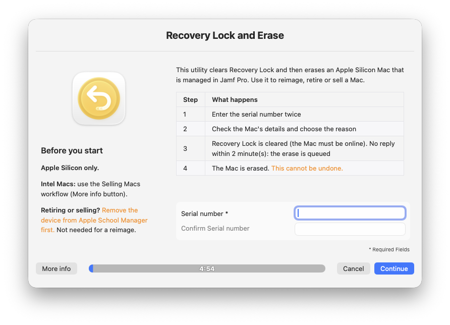
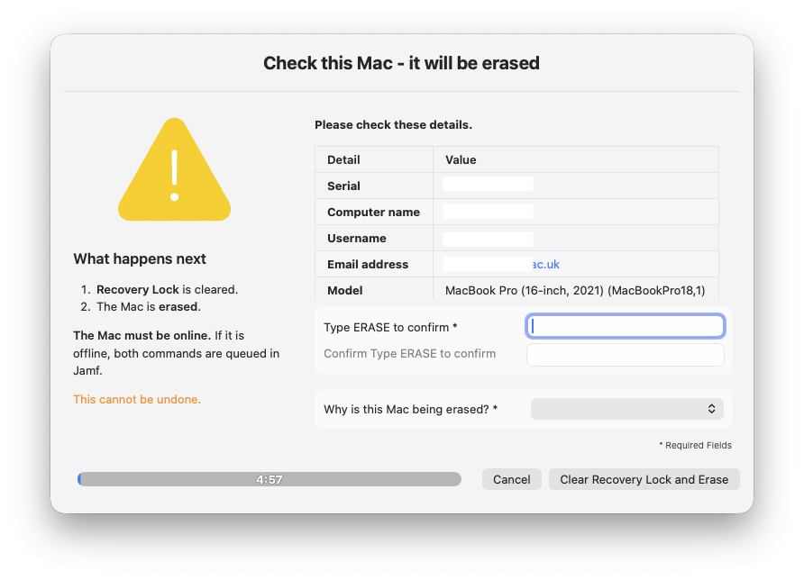
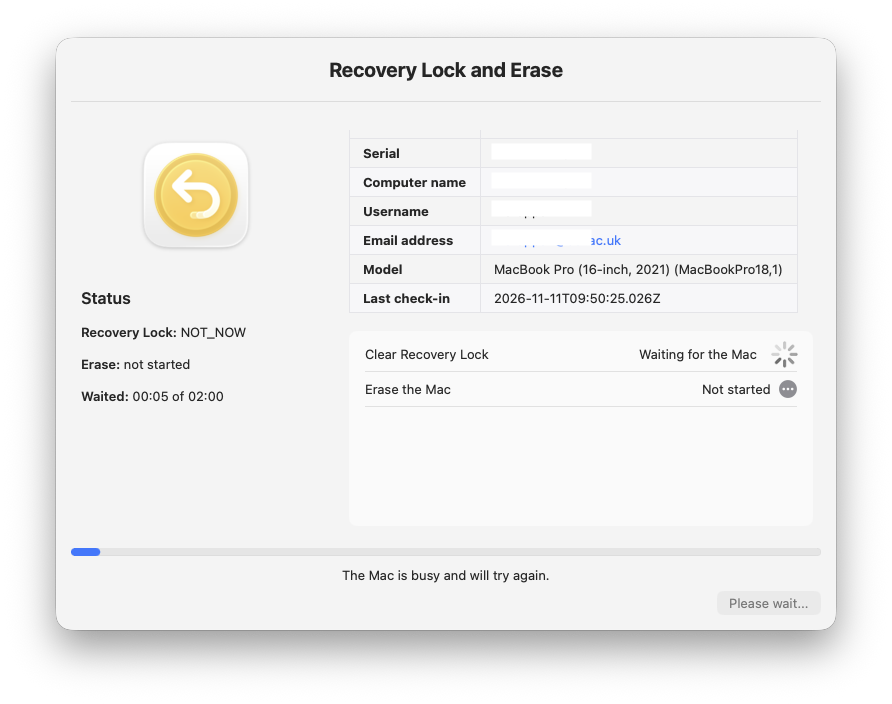
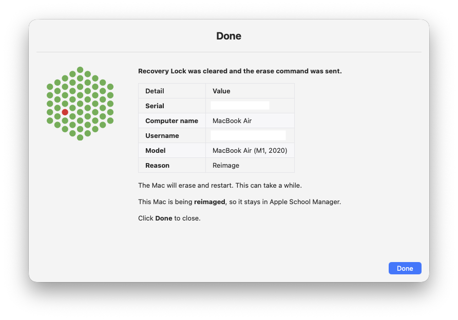

# Jamf Pro Recovery Lock Clear and Erase

`recovery-lock-clear-and-erase-by-serial.sh` (version `1.0.0`) clears the Recovery Lock, erases, or does both, on an Apple Silicon Mac that is managed in Jamf Pro. Use it to reimage, retire or sell a Mac, or only to clear a Recovery Lock password.

**It runs from an admin's or technician's own Mac, as a Jamf Self Service policy.** The admin or technician enters the **serial number of the Mac to erase**. The script does not run on the Mac being erased.

## What it does

Two script variables choose the job (`yes` or `no`):

| `SCRIPT_CLEAR_RECOVERY_LOCK` | `SCRIPT_ERASE_DEVICE` | Result |
|:--|:--|:--|
| `yes` (default) | `yes` (default) | Clear Recovery Lock, then erase |
| `yes` | `no` | **Clear Recovery Lock only.** The Mac is not erased. |
| `no` | `yes` | **Erase only.** Recovery Lock is not touched. |
| `no` | `no` | **Error.** Nothing to do, the script stops (exit 1) and changes nothing. |

Any value other than `yes` or `no` is also an error. The steps below are for both `yes`; the other modes skip the steps they don't need.

1. Asks for the serial number twice.
2. Finds the Mac in Jamf Pro and shows its details (name, username, email, model, last check-in).
3. The admin or technician picks the reason (reimage, or retired or sold) and types `ERASE`. *(Erase modes only. For Recovery Lock only they just click **Clear Recovery Lock**.)*
4. Clears Recovery Lock with a Jamf MDM command and waits up to 2 minutes for the Mac to confirm. *(Skipped for erase only.)*
5. Sends the erase command. If the Mac is offline, the erase is queued in Jamf behind the Recovery Lock command. *(Skipped for Recovery Lock only. For erase only it is sent straight away.)*
6. Shows the result. Every window is swiftDialog, and each run is written to a log in `~/Library/Logs`.
7. Optional: posts Slack alerts when an erase is requested and when it finishes or fails (parameter 8).

**Apple Silicon only.** For an Intel Mac nothing is changed, and the window points to your own procedure (parameter 7).

## Screenshots

| Enter the serial number | Check the Mac and confirm |
|:--:|:--:|
|  |  |

| Progress | Result |
|:--:|:--:|
|  |  |

## Quick start

1. In Jamf Pro, create an API role with the four privileges in [Requirements](#requirements) and an API client that uses it.
2. Add the script under *Settings > Computer Management > Scripts*.
3. Create a policy with the script. Trigger: **Self Service** only. Frequency: **Ongoing**.
4. Set parameters 4, 5 and 6 (Jamf URL, client ID, client secret). Keep `SCRIPT_DRY_RUN="yes"` in the script for now. Leave `SCRIPT_CLEAR_RECOVERY_LOCK` and `SCRIPT_ERASE_DEVICE` at `yes`, or set one to `no` for a single-purpose policy (for example, one policy that only clears Recovery Lock).
5. Scope the policy to the admin and technician Macs **and** limit it to their user group. This access is the main control, because the policy can erase any Apple Silicon Mac in Jamf Pro.
6. **Test in a Jamf Pro sandbox (non-production) first**, on a spare Mac (see [Testing](#testing)). Only after it works there, set `SCRIPT_DRY_RUN="no"` and use it in production.

## Contents

- [Screenshots](#screenshots)
- [Requirements](#requirements)
- [How a run works](#how-a-run-works)
- [Safety controls](#safety-controls)
- [Configuration](#configuration)
- [Logging](#logging)
- [Slack alerts](#slack-alerts-optional)
- [Security](#security)
- [Troubleshooting](#troubleshooting)
- [Testing](#testing)
- [APIs used](#apis-used)
- [Limitations](#limitations)

## Requirements

| Item | Requirement |
|---|---|
| Jamf Pro | An API client whose role has only (an action set to `no` does not need its privilege): **Read Computers**, **View MDM command information in Jamf Pro API**, **Send Set Recovery Lock Command**, **Send Computer Remote Wipe Command** (confirm the names in your Jamf version) |
| Admin or technician Mac | macOS 15 Sequoia or later, a logged-in user, [swiftDialog](https://swiftdialog.app/) at `/usr/local/bin/dialog` (3.1 was used), network access to Jamf Pro |
| Mac to erase | Apple Silicon, enrolled and MDM managed in Jamf Pro. Online, or the commands queue. |
| Tools | `curl`, `plutil`, `launchctl`, `dscl`, `ioreg` (all included with macOS) |

## How a run works

| Stage | What the admin or technician sees | What the script does |
|---|---|---|
| 1. Serial | A short description, an info box with reminders (Apple Silicon only, Intel Macs, remove from Apple School Manager when retiring or selling) and the serial field twice. A **More info** button opens your article. | Checks the format. swiftDialog checks both entries match. |
| 2. Lookup | Nothing | Gets a Jamf token. Reads exactly one computer record. Checks the serial, that the Mac is managed, the chip type and the management ID. |
| 3. Confirm | A table of details. With erase: one required reason list and a field to type `ERASE`. Recovery Lock only: just a **Clear Recovery Lock** button. | Rejects a missing reason or a wrong `ERASE` and asks once more. |
| 4. Recovery Lock *(if on)* | Progress window with a checklist and a live status box | Sends `SET_RECOVERY_LOCK` (empty password), checks its state every 15 seconds. |
| 5. Erase *(if on)* | Same window | Sends `ERASE_DEVICE` once Recovery Lock is acknowledged, **or** after the wait if the command is still Pending, so Jamf queues it. Erase only: sent straight away. |
| 6. Result | A new result window with a result table and a **Done** button (no timeout) | Writes the outcome to the log. |

The reason list has two choices. **Reimage the device** needs no Apple School Manager step. **Retired or Sold - Removed from Apple School Manager** is the confirmation that the device was removed first. Return and Esc need Cmd+Shift in the confirm window, so a stray key press cannot confirm. The two question windows close with nothing changed if left unanswered, (see `SCRIPT_PROMPT_TIMEOUT`). The result window has no timeout. There is no Cancel button once the commands are sent: wait for **Done**. The progress window (the wait of up to 2 minutes) is a normal window. The final windows (result, error and notices) stay on top of other windows. The result window has no timeout: it stays until **Done** is clicked.

## Safety controls

- If `SCRIPT_CLEAR_RECOVERY_LOCK` and `SCRIPT_ERASE_DEVICE` are both `no`, or either is not `yes`/`no`, the script stops with an error before any window asks for a serial.
- Nothing is sent unless `SCRIPT_DRY_RUN` in the script is `no`. Any other value is a dry run (details only). It is a script setting only, not a policy parameter.
- The Mac must be managed in Jamf Pro (`general.remoteManagement.managed` is `true`). An unmanaged record stops the script with "Mac is not managed" before any command is sent, even in a dry run.
- Exactly one computer record must match the serial. No match, duplicates or a different serial stop the script.
- The command is built for exactly one device, and a second erase in the same run is refused.
- When both are on, the erase is sent only if Recovery Lock was **acknowledged**, or the command is still **Pending / Not Now** at the end of the wait (for example the Mac is offline). An error, or a command Jamf cannot find, means **no erase** ("The Mac was NOT erased").
- With Recovery Lock only, no erase command exists in that run. With erase only, Recovery Lock is not touched.
- Jamf requires a 6-digit PIN on the erase command. A random one is sent and never shown or logged. Apple Silicon does not use it.
- Errors from Jamf are shown in plain language with the step that failed.

## Configuration

### Policy parameters

| # | Setting | Notes |
|---|---|---|
| 4 | Jamf Pro URL | `https://yourorg.jamfcloud.com` |
| 5 | API Client ID | |
| 6 | API Client secret | Visible in policy logs. Use a limited role and rotate if exposed. |
| 7 | Intel Mac article URL | Optional. `https://` link behind the **More info** button. |
| 8 | Slack webhook URL | Optional. Leave empty for no Slack alerts. See [Slack alerts](#slack-alerts-optional). |

### Adding the script in Jamf

1. *Settings > Computer Management > Scripts > New*. Paste the script. Keep `SCRIPT_DRY_RUN="yes"` until you have tested.
2. On the **Options** tab, give parameters 4 to 8 these labels. They are the names the policy shows.

| Parameter | Label | Required |
|---|---|---|
| 4 | Jamf Pro URL | Yes |
| 5 | API Client ID | Yes |
| 6 | API Client Secret | Yes |
| 7 | Intel Mac article URL | No |
| 8 | Slack webhook URL | No |

3. In the policy, open **Scripts**, add the script and fill in the values:

| Parameter | Example value |
|---|---|
| 4 | `https://yourorg.jamfcloud.com` (no trailing slash needed) |
| 5 | `<api-client-id>` |
| 6 | `<api-client-secret>` |
| 7 | `https://your-kb-site/intel-mac-article` or empty |
| 8 | `https://hooks.slack.com/services/<T>/<B>/<token>` or empty |

Use your own values, never the examples. Leave 7 and 8 empty to skip them. Parameters 9 and above are not used. Everything else (dry run, clear Recovery Lock, erase, wait time, icon) is set in the script, not in the policy.

Each parameter falls back to a `SCRIPT_` variable at the top of the script (`SCRIPT_JAMF_URL`, `SCRIPT_CLIENT_ID`, `SCRIPT_CLIENT_SECRET`, `SCRIPT_INTEL_KB_URL`, `SCRIPT_SLACK_WEBHOOK_URL`). A policy parameter wins when set. Prefer parameters for the URL, client ID and secret, and never commit a real secret.

### Script variables

These have no policy parameter. Change them in the script.

| Variable | Default | Use |
|---|---|---|
| `SCRIPT_DRY_RUN` | `yes` | `yes` = show details only. `no` = make changes. |
| `SCRIPT_CLEAR_RECOVERY_LOCK` | `yes` | `yes` = send the Clear Recovery Lock command. `no` = skip it. |
| `SCRIPT_ERASE_DEVICE` | `yes` | `yes` = send the erase command. `no` = skip it (no reason or `ERASE` is asked). Both `no` is an error. |
| `SCRIPT_WAIT_SECONDS` | `120` | Seconds to wait for the Mac to confirm Recovery Lock before the erase is queued (10-120) |
| `SCRIPT_OBLITERATION` | `Default` | `obliterationBehavior` of the erase: `Default`, `DoNotObliterate`, `ObliterateWithWarning` or `Always` |
| `SCRIPT_ICON` | empty (info icon) | Icon for the first and progress windows: file path, `https://` URL or `SF=symbol` |
| `SCRIPT_DIALOG_TITLE` | `Recovery Lock and Erase` | Window title. If left at the default, it becomes **Clear Recovery Lock** (Recovery Lock only) or **Erase Mac** (erase only). |
| `SCRIPT_ASM_NAME` | `Apple School Manager` | Use `Apple Business Manager` if that is what you use. Appears in the reminders and the reason list. No commas. |
| `SCRIPT_KB_NAME` | `Selling Macs` | Name of your Intel Mac article or workflow. No commas. |
| `SCRIPT_SUPPORT_CONTACT` | empty | Added to error windows as "Need help? ..." |
| `SCRIPT_DIALOG_BIN` | `/usr/local/bin/dialog` | swiftDialog location |
| `SCRIPT_PROMPT_TIMEOUT` | `300` | Seconds before an unanswered question window closes with nothing changed (30-3600, or `0` for no timeout). A countdown is shown. |
| `SCRIPT_DOCK_ICON` | Erase Assistant icon (a macOS system file) | Icon shown in the Dock while a window is open: file path or `https://` URL. Empty = swiftDialog's own icon. |
| `SCRIPT_LOG_DIR` | empty (`~/Library/Logs`) | Log folder |

## Logging

Everything the script prints goes to the Jamf policy log **and**, with timestamps, to the logged-in admin's or technician's `~/Library/Logs/recovery-lock-clear-and-erase-by-serial.log`.

- The file belongs to that user (mode `600`). One old copy is kept once it passes 1 MB.
- **It records:** who ran it and on which Mac, the serial, computer name, username, model and last check-in of the Mac to erase, the chosen reason, each command's id and state, and a final `RESULT:` line.
- **It never records:** the client secret, a token or the erase PIN.
- It holds personal data about the owner of the erased Mac (username). Handle it under your retention policy. The policy log in Jamf holds the same lines for central audit.
- If the file cannot be written, the script continues and says so in the policy log.

## Slack alerts (optional)

Set parameter 8 (or `SCRIPT_SLACK_WEBHOOK_URL`) to a Slack incoming webhook URL (`https://hooks.slack.com/...` or GovSlack) and the script posts **one message per run**, with the final status. With no URL, nothing is posted. Create the webhook as described in [Jamf-Pro-Slack-Notifications](../Jamf-Pro-Slack-Notifications/); the message format and escaping follow that tool.

| When | Colour | Header |
|---|---|---|
| Done (Recovery Lock cleared and/or Device Wipe Command sent) | Green | Device Wipe Command sent (or Recovery Lock cleared, Device Wipe Command sent) |
| The Mac did not reply, commands queued | Orange | Mac did not reply - ... queued in Jamf |
| Anything fails after the request | Red | Recovery Lock and Erase FAILED (with a **Problem** box) |

The header names the action (Recovery Lock and Erase, Recovery Lock clear, or Erase) and has an emoji. Below it, the details sit in two columns: **Serial, Computer name, Model, Action, User, Email, Reason** (erase modes only) and **Status**. A small footer shows the **login name of the admin or technician**, the **serial of the Mac the script ran from** and the script version. Dry runs and runs cancelled before the confirm post nothing.

- The alert is best effort. If Slack cannot be reached, the script logs a warning and carries on, so the erase is never blocked or changed by Slack.
- The webhook URL is a credential. Like the client secret it appears in policy logs, so rotate it if exposed. The script sends it to `curl` on stdin and never logs it.
- The messages contain a person's name and email. Use a channel whose members may see that.
- The admin and technician Macs need network access to `hooks.slack.com` (or `hooks.slack-gov.com`).

## Security

- **Least privilege:** the API role needs only the four privileges above. Do not reuse an administrator client.
- **Secret handling:** the secret is sent from a private temp file (not the command line) and the token on stdin (not in the process list). The token is renewed at half its lifetime and invalidated at the end. Policy parameters appear in Jamf policy logs, so rotate the secret if it is exposed.
- **Input:** the serial is limited to letters and digits before it is used in an API filter. Text from Jamf cannot break out of the window code.
- **Who can run it:** control it with the policy scope and user groups.
- **Slack webhook:** if you use alerts, treat the webhook URL like the secret (see [Slack alerts](#slack-alerts-optional)).
- **After the erase:** the Mac returns unmanaged (no Return to Service). Activation Lock is not touched. Release the Mac from Apple School/Business Manager and delete it from Jamf Pro yourself. Release it before the erased Mac goes online, or it shows the enrolment prompt again.
- **The erase is permanent.** Test on a non-production Mac first.

## Troubleshooting

| Message or symptom | Likely cause and action |
|---|---|
| "Serial number not found, or duplicate records" | Wrong serial, or two records with the same serial (for example after a logic board replacement). Delete the stale record in Jamf, then run again. |
| "Intel Mac - not supported" | Follow your Intel Mac procedure. Nothing was changed. If an Apple Silicon Mac shows as Intel, check the chip type in its Jamf inventory record. |
| "Mac is not managed" | The computer record is unmanaged. Nothing is sent. |
| "This Mac cannot receive commands" | No management ID, so the Mac is not MDM managed. |
| HTTP 401 or 403 | Check the API client, secret and role privileges. |
| HTTP 404 on commands | Jamf has no MDM-managed device for this record (stale or unenrolled). |
| "Recovery Lock was not confirmed" | The command was not found or did not stay Pending. The Mac was **not** erased. Check the command history in Jamf. |
| "Queued - the Mac did not reply" | Jamf sends both commands when the Mac connects. Release it from ASM/ABM first. |
| No windows | Nobody is logged in, or swiftDialog is missing at `SCRIPT_DIALOG_BIN`. |
| No log file | Look for `WARNING` about the log file in the policy log. |

## Testing

`bash -n` and ShellCheck pass. The script was exercised end to end against a mocked Jamf and a mocked swiftDialog, and swiftDialog `--timer` and exit-code behaviour was checked on 3.1.1. **It has not been run against a real Jamf Pro tenant, and the window layout (tables, info boxes) has not been confirmed on screen.** **Test in a Jamf Pro sandbox (non-production) tenant before you use it in production.** Test before use:

0. Set both new variables to `no`: confirm the script stops with the "Nothing to do" error and sends nothing. This was checked with a stubbed swiftDialog, along with the first window text for each mode. The later windows, the progress flow and Slack in the Recovery Lock only and erase only modes have **not** been run.
1. Dry run (`SCRIPT_DRY_RUN="yes"`): check the details table and the log file. Repeat for each mode you will use.
2. Real run on an **online** test Mac: check the commands in Jamf, the result window and the log. Repeat with Recovery Lock only and erase only.
3. Real run on an **offline** test Mac: confirm both commands queue and run when it connects.
4. An Intel Mac serial: confirm nothing is sent and the article opens.
5. Wrong API privileges: confirm the error is clear and nothing is erased.

## APIs used

All calls go to your Jamf Pro URL.

| API | Used for | Role privilege |
|---|---|---|
| `POST /api/oauth/token` | Gets an access token with the API client ID and secret | None |
| `GET /api/v4/computers-inventory` | Finds the Mac by serial number and reads its name, username, email, model, chip type, managed state (`general.remoteManagement.managed`), management ID and last check-in | Read Computers |
| `POST /api/v2/mdm/commands` | Sends the `SET_RECOVERY_LOCK` command (empty password) and/or the `ERASE_DEVICE` command, depending on the mode | Send Set Recovery Lock Command, Send Computer Remote Wipe Command |
| `GET /api/v2/mdm/commands` | Checks the state of the Recovery Lock command (Pending, Acknowledged, Error). Not used for erase only. | View MDM command information in Jamf Pro API |
| `POST /api/v1/auth/invalidate-token` | Ends the token at the end of the run | None |

## Limitations

- Apple Silicon only. Intel Macs are not handled.
- **One serial number per run.** To erase several Macs, run the policy once for each.
- **Duplicate serial numbers stop the script.** Jamf can hold two records with the same serial, for example after Apple replaces a logic board and the Mac enrols again under the old serial. The script needs exactly one record, so it stops and changes nothing. Delete the stale record in Jamf Pro, then run it again. It never guesses which record is the right one, because the command would go to a device by its management ID.
- The erase is sent without Return to Service.
- Erase only does not clear Recovery Lock. How a Mac with a Recovery Lock password reacts to the erase was not tested.
- It needs a logged-in user on the admin's or technician's Mac.
- The script confirms that Jamf accepted the erase command, not that the erase finished.
- The `SET_RECOVERY_LOCK` request follows Jamf's article [Recovery Lock Enablement in macOS Using the Jamf Pro API](https://learn.jamf.com/r/en-US/technical-articles/Recovery_Lock_Enablement_in_macOS_Using_the_Jamf_Pro_API) (an empty `newPassword` clears the lock). Jamf does not document the PIN on `ERASE_DEVICE`, so confirm that in your own tenant.

## References

- [Jamf Pro API: MDM commands](https://developer.jamf.com/jamf-pro/reference/post_v2-mdm-commands)
- [Jamf Pro API: computer inventory (v4)](https://developer.jamf.com/jamf-pro/reference/get_v4-computers-inventory)
- [swiftDialog documentation](https://swiftdialog.app/)
- [Jamf-Pro-Recovery-Lock-API](../Jamf-Pro-Recovery-Lock-API/) (separate tool)

  <a href="https://www.linkedin.com/in/bewithkarthi/">Karthikeyan Marappan</a>

